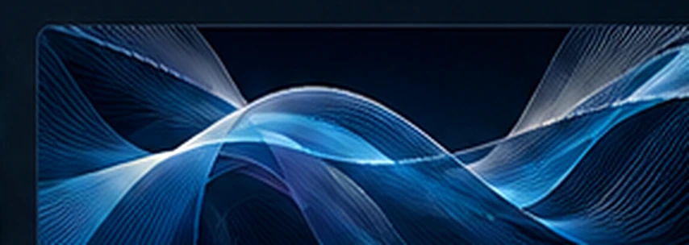

EGOTHOR / RESEARCH-DRIVEN SOFTWARE
<h1>Projects & applied research</h1>
Publications are listed with their corresponding projects. These records distinguish independently developed work from later commercial adaptations.

<a class="lg-card" href="jai/">
<h3>JAI</h3>Justifiable AI
Research-driven AI with auditable reasoning and evidence.
Paper · Code · Docs <b aria-hidden="true">→</b>
</a>
<a class="lg-card" href="egothor-v4/">
<h3>EGOTHOR v4</h3>Search engine platform
Full-text retrieval, indexing and scalable search architecture.
Code · Architecture <b aria-hidden="true">→</b>
</a>
<a class="lg-card" href="radixor/">
<h3>Radixor</h3>Language technology
Learned morphological models and multilingual evaluation.
9 research manuscripts <b aria-hidden="true">→</b>
</a>
<a class="lg-card" href="zeroecho/">
<h3>ZeroEcho</h3>Cryptography & PKI
Cryptographic services, security engineering and resilient key handling.
Code · Documentation <b aria-hidden="true">→</b>
</a>
<a class="lg-card" href="conflux/">
<h3>conflux</h3>Java infrastructure
Type-safe coordination and event processing across contexts.
Code · Architecture <b aria-hidden="true">→</b>
</a>
<a class="lg-card" href="methodatlas/">
<h3>MethodAtlas</h3>Methodology & software assurance
Methodology tooling developed from an Egothor concept and later adapted for commercial use.
Approach · Background <b aria-hidden="true">→</b>
</a>

JAI, EGOTHOR v4, Radixor, ZeroEcho and conflux are presented within the independent Egothor portfolio. MethodAtlas originated in Egothor work and its methods were subsequently adapted for commercial use; no employer association or endorsement is implied.

1998—PRESENT<strong>Earlier engineering and research</strong>
Egothor v1–v3, Galeo, J5M, Q!D, Cyclone, RaSPEL, SafetyCare, Bobo and more.

<a href="heritage/">Explore the archive →</a>

